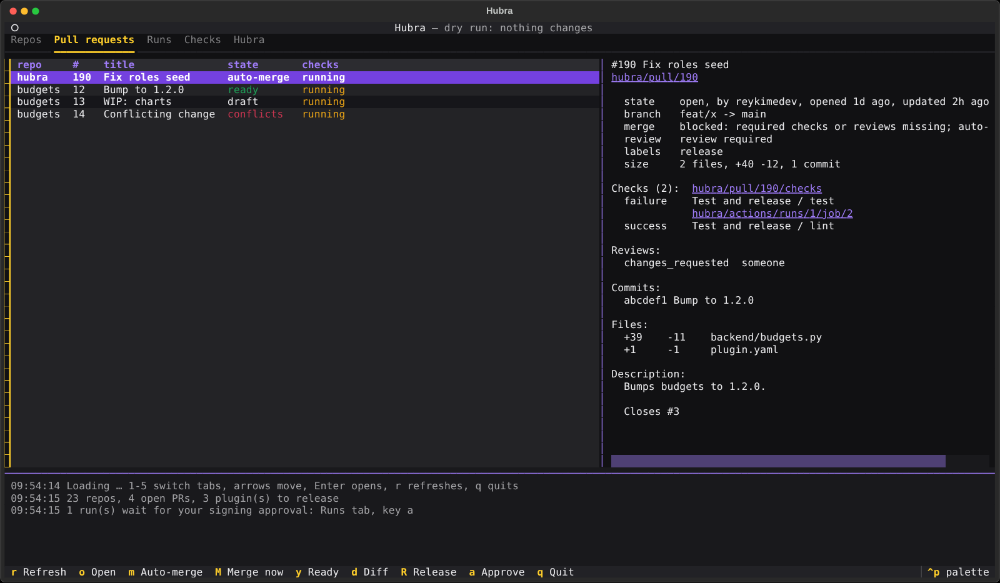
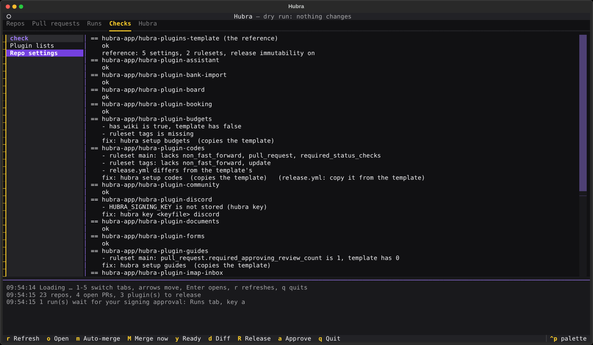

# hubra-cli

The `hubra` command for the hubra-app GitHub repos and the running Hubra:
status of every repo, pull requests, merges, plugin releases, signing
approvals, and Hubra's health, alerts, errors and jobs. `hubra tui` shows all
of it on one full-screen view.



## Install

Needs Python 3.9+ and the [gh CLI](https://cli.github.com) logged in as an
owner of hubra-app (`gh auth login`; if asked: `gh auth refresh -s
admin:org,workflow`).

```sh
pipx install "hubra-cli[tui] @ git+https://github.com/hubra-app/hubra-cli"
pipx upgrade hubra-cli                 # later, when the version went up
# same version but newer code (e.g. main between releases):
# pipx install --force "hubra-cli[tui] @ git+https://github.com/hubra-app/hubra-cli"
# without the TUI: pipx install git+https://github.com/hubra-app/hubra-cli
```

Without the `[tui]` extra everything except `hubra tui` works, using only
the standard library.

## Commands

```sh
hubra status                  # every repo in one table (one GraphQL query)
hubra prs                     # every open PR with checks, review, link
hubra pr budgets#12 --diff    # one PR in depth (--web opens it)
hubra merge                   # auto-merge ready plugin PRs
hubra merge budgets#12        # only this PR (--now merges at once, --ready un-drafts)
hubra release                 # tag new plugin.yaml versions; the workflow signs and releases
hubra ship                    # merge, then release
hubra approve                 # approve signing runs waiting for you
hubra runs --failed           # recent failed Actions runs
hubra open budgets#12         # open a repo / PR / --actions / --releases page
hubra bump budgets minor      # PR with plugin.yaml + CHANGELOG for the next version
hubra lists                   # plugin lists vs releases (--fix opens PRs)
hubra doctor                  # repos that drifted from the template (--fix applies it)
hubra sync                    # PRs that copy the template's shared files to plugins
hubra verify                  # check the latest release zips against Hubra.pub
hubra security                # open Dependabot, secret- and code-scanning alerts
hubra setup                   # create new plugin repos, copy the template's setup
hubra key signing.key         # store the plugin signing key
hubra login                   # save a Hubra API token
hubra hubra health            # also: alerts, errors, jobs, whoami, get PATH
hubra tui                     # everything on one screen
```

Repo names are plugin short names (`budgets`) or `hubra`, `hubra.club`,
`hubra-plugins`; `name#12` or a PR URL names one pull request. `hubra --help`
and `hubra <command> --help` explain every option. `--dry-run` shows what
would change without changing anything.

A plugin release goes: `hubra bump budgets` (PR with the new version and
changelog) → merge → `hubra release budgets` (pushes the tag v<version>) →
`hubra approve` (signing; release.yml then creates the release with the zip,
so releases can be immutable) →
`hubra lists --fix` (version bumps in the READMEs; new rows, hubra.club cards
and the org profile stay yours, see hubra docs/plugin-releases.md).

## The template is the reference

`hubra-plugins-template` as it is on GitHub now is what every plugin repo
should look like. `hubra doctor` compares each plugin with it: repo settings
(merge buttons, auto-merge, wiki, …), security features, release immutability,
private vulnerability reporting, every ruleset rule by rule (conditions,
parameters, bypass) and release.yml. Change something in the template and every
plugin shows it as drift; `hubra setup <name>` copies it over. doctor also
checks the template itself: its live rulesets against its `.github/rulesets`
files, and auto-merge, branch deletion, wiki and projects.

Each repo's own `.github/rulesets/*.json` files count too. doctor reports a
file that isn't imported or differs from the live ruleset, a plugin's file that
differs from the template's file of the same name, and a live ruleset that is
neither in the template nor in the repo's files. Core repos (hubra, …) are
checked against their own files only. `hubra setup` imports a plugin's extra
rulesets (names the template doesn't have) from its files.

`hubra doctor --fix` applies what it can: the template's settings, security
features, release immutability and rulesets on each plugin, the repo's own
rulesets files on every repo, and the settings plugins need on the template
itself (first, so the plugins get them). The plugin-signing environment stays
with `hubra setup`, the key with `hubra key`, and files with `hubra sync`, which
opens one PR per plugin for the shared files in `SYNC_FILES` (release.yml,
rulesets files, PR template, SECURITY.md, LICENSE, .gitignore, .gitattributes).

## Verify a release

`hubra verify [names] [--tag v1.2.0]` downloads each plugin's release zip and
checks it the way Hubra does before installing it: the `.sha256` file, the
`SIGNATURE.json` key (must be Hubra.pub), every file hash, the Ed25519
signature, and id and version against plugin.yaml and the tag.

## Links over SSH

Over SSH (`SSH_CONNECTION` set) a link doesn't start a browser on the server:
Enter, `o` or a click copies the URL to your own clipboard (OSC 52, which
iTerm2, kitty, WezTerm, Windows Terminal and tmux with `set -g set-clipboard
on` pass on; iTerm2 asks once under Settings › General › Selection) and shows
the full URL in the log to cmd/ctrl-click. `HUBRA_OPEN=browser`, `copy` or
`print` picks the behaviour yourself.

## Hubra API

`hubra hubra …` and the TUI's Hubra tab read the running Hubra with an API
token (manage › API-Tokens; a read-only platform token with
`platform.diagnostics` is enough). `hubra login` keeps it in
`~/.config/hubra/token`, readable only by you; `HUBRA_TOKEN` overrides it.
`HUBRA_API_URL` (default `https://api.hubra.club`) and `HUBRA_MANAGE_URL`
point at another install.

## TUI keys

Tabs: Repos, Pull requests, Runs, Security (open alerts), Checks (plugin lists, doctor, release zips) and Hubra,
in the Hubra colours (`t` switches to the light theme).
`←` `→` or `1`-`6` switch tabs and `↑` `↓` move right away · `Enter` or `o` open in
the browser · `r` refresh · `m` auto-merge · `M` merge now · `y` mark ready ·
`A` auto-merge all ready PRs · `d` diff · `R` release · `a` approve a waiting run (signing or an outside contributor's run; the Runs tab and the header show how many wait) · `q` quit. Links in the detail
pane and the log are short labels you can click. Every change asks first;
`hubra tui --dry-run` only shows what it would do.



## As a bnb plugin

[bitsandbricks](https://github.com/bitsandbricks-ch/bitsandbricks-cli) (`bnb`) is the general version of this tool: any org, defaults kept in a repo you pick, doctor and sync across all of them. hubra-cli plugs into it:

```sh
pipx install "git+https://github.com/bitsandbricks-ch/bitsandbricks-cli#egg=bitsandbricks-cli[tui]"
pipx inject bitsandbricks-cli "git+https://github.com/hubra-app/hubra-cli"
bnb init bitsandbricks-ch/bitsandbricks-defaults
```

bnb then has `release`, `ship`, `bump`, `verify`, `key`, `setup`, `lists`, `hubra`, `login` and `logout` from here, plugin.yaml columns in `bnb status`, the plugin-signing checks in `bnb doctor`, and in `bnb tui` the Hubra tab, Checks › Plugin lists and Release zips, keys b, R and S, and the Hubra themes (t). The `hubra` command keeps working on its own.

## Development

```sh
pip install -e ".[dev]"
ruff check . && pytest
```

The tests never touch GitHub or Hubra: `tests/fake_gh` stands in for gh with
a made-up org and `tests/fake_hubra.py` for the Hubra API. To try a command
by hand against them:

```sh
mkdir -p /tmp/fakebin && ln -sf "$PWD/tests/fake_gh" /tmp/fakebin/gh
python tests/fake_hubra.py 8765 &
export PATH=/tmp/fakebin:$PATH HUBRA_API_URL=http://127.0.0.1:8765 \
       HUBRA_TOKEN=hbr_plat_AAAAAAAAAAAA_BBBBBBBBBBBBBBBBBBBBBBBBBBBBBBBBBBBBBBBBBBB
hubra status && hubra ship --dry-run
```

## Licence

Source-available, see [LICENSE](LICENSE).
